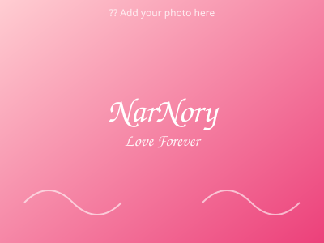

# NarNory - Our Romantic Scrapbook

A beautiful, responsive romantic scrapbook website created with plain HTML, CSS, and JavaScript. All your memories in one place, saved locally on your device.



## Features

- ?? **Romantic Design** - Warm cream textures, blush pink accents, hearts, and Polaroid-style photos
- ?? **Day Counter** - Track how many days, months, and years you've been together (fully customizable)
- ?? **Photo Gallery** - Add your own photos with editable captions
- ??? **Timeline** - Document your important memories with dates and descriptions
- ?? **Love Letter** - A personal, editable love letter saved locally
- ?? **Music Player** - Play your special song by selecting a local audio file
- ? **Interactive Surprise** - Click to reveal a sweet message
- ?? **Fully Responsive** - Works beautifully on desktop, tablet, and mobile
- ?? **Local Storage** - Your edits are saved in your browser

## Project Structure

```
D:\naro &batot swr\
+-- index.html          # Main HTML file
+-- css/
¦   +-- style.css       # All styles and animations
+-- js/
¦   +-- script.js       # All interactivity and local storage
+-- assets/
¦   +-- images/         # Photos and placeholders
¦   +-- music/          # Your local music files (optional)
+-- README.md           # This file
```

## How to Open Locally

1. Navigate to the project folder: `D:\naro &batot swr\`
2. Double-click `index.html` to open it in your default browser
3. Or right-click `index.html` ? Open with ? Your preferred browser

That's it! No server, no dependencies needed.

## Customization Guide

### 1. Change the Start Date
- Open `js/script.js`
- Find `const DEFAULT_START_DATE = '2025-01-01'`
- Change to your actual start date in `YYYY-MM-DD` format
- You can also change it directly on the website and it will be saved

### 2. Add Your Own Photos
You have two options:

**Option A: Upload directly on the website (easiest)**
1. Open the website
2. Go to the "Gallery" section
3. Click "Add Photos" and select images from your computer
4. Click on captions to edit them
5. Photos are saved in your browser's local storage

**Option B: Replace placeholder images (recommended for permanent setup)**
1. Copy your photos to `assets/images/`
2. Rename them (e.g., `photo1.jpg`, `photo2.jpg`)
3. Open `index.html` and find the gallery section
4. Replace the `src` or `background-image` URLs in the placeholder cards, or just replace the placeholder SVG files
5. For placeholders, you can replace `placeholder1.svg`, `placeholder2.svg`, `placeholder3.svg` with your own images (jpg/png/webp)

**Note:** If you provided a photo link separately, download the photos and add them using either method above.

### 3. Add Your Music
1. Open the website
2. Go to "Our Song" section
3. Click "Choose Music" and select an audio file from your computer (MP3, WAV, OGG supported)
4. The music will play in the built-in audio player
5. Note: The file is played from your device, not uploaded

### 4. Customize the Love Letter
- On the website: Click the love letter text and type your own message
- Or edit `js/script.js`: Look for `DEFAULT_SURPRISE_MESSAGE` and other defaults
- Changes are saved automatically in your browser

### 5. Edit the Surprise Message
- Open `js/script.js`
- Find `const DEFAULT_SURPRISE_MESSAGE = '...'`
- Replace with your own sweet message

### 6. Change Colors & Fonts
- Open `css/style.css`
- Modify the CSS variables in `:root` at the top
- Change fonts by updating the Google Fonts link in `index.html` and CSS

### 7. Add More Timeline Memories
- Click "Add Memory" button in the Timeline section
- Edit the title, date, and description directly on the page
- All timeline items are saved locally

## How it Saves Data

This website uses your browser's **Local Storage** to save:
- Custom start date
- Photo gallery additions (photos are stored as base64 data)
- Timeline entries
- Love letter text
- Music filename

**Important Notes:**
- Data is stored on the device and browser you're using
- It does NOT automatically sync between devices (phone, laptop, etc.)
- Clearing your browser data will delete saved customizations
- Local storage has size limits (usually ~5-10MB), so very large photos may cause issues - resize them if needed

## Publishing Online (Static Hosting)

Since this is a pure static website (HTML, CSS, JS), you can host it for free on many platforms:

1. **GitHub Pages** (Free, easy)
   - Create a GitHub repository
   - Upload all files
   - Go to Settings > Pages > Deploy from branch
   - Your site will be at `https://yourusername.github.io/repository-name/`

2. **Netlify** (Free)
   - Go to [netlify.com](https://www.netlify.com)
   - Drag and drop the entire folder `D:\naro &batot swr`
   - Get instant live URL

3. **Vercel** (Free)
   - Go to [vercel.com](https://vercel.com)
   - Import your project
   - Deploy with zero configuration

4. **Cloudflare Pages** (Free)
   - Go to [pages.cloudflare.com](https://pages.cloudflare.com)
   - Upload files or connect to Git
   - Fast global CDN

**Privacy & Security:**
- This site has no backend, no database, no login
- Nothing is sent to any server - everything runs in your browser
- When hosted publicly, anyone with the URL can view it
- There is NO built-in password protection. If you want privacy, use a platform that supports password protection or don't share the link
- Do not put sensitive/private info in the text fields if you plan to share it publicly

## Troubleshooting

- **Images not showing**: Check file paths. Use relative paths like `assets/images/photo.jpg`
- **Changes not saving**: Make sure you're not in Private/Incognito mode (localStorage may be disabled)
- **Audio not playing**: Some browsers block autoplay; click play manually
- **Mobile layout issues**: Clear browser cache and refresh

## Tips for Best Experience

1. Resize large photos to ~800-1200px width for faster loading
2. Use compressed images (WebP/JPG) to save space
3. Test on both mobile and desktop after customization
4. Keep a backup of the folder and your original photos
5. The default font uses Google Fonts - needs internet for first load, but cached after

## Credits

Made with ?? for NarNory. Customize it to tell your unique love story!

---

**Need help?** Check the comments in the code files - they explain where to customize each part!
